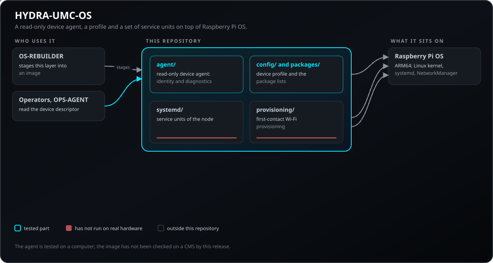
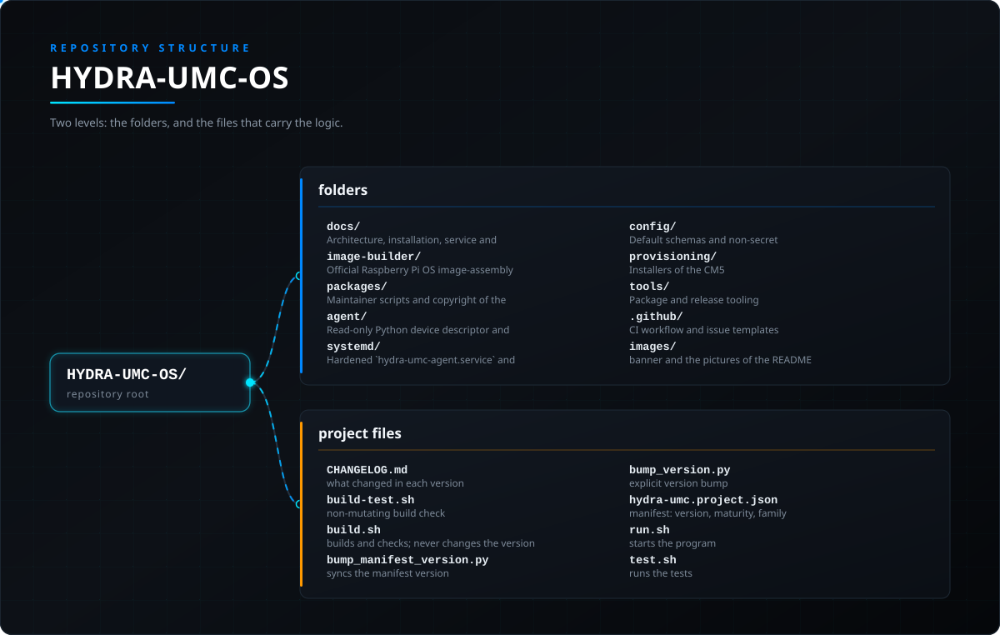

<!-- =============================================================================
HYDRA-UMC-OS - Platform layer for a CM5 node on Raspberry Pi OS
Copyright (C) JuanenRac (Electro Hobby 3D) <electrohobby3d@gmail.com>
GPL-3.0-or-later - see LICENSE
============================================================================= -->

<p align="center">
  
</p>

# 🖥️ HYDRA-UMC-OS

<p align="center"><a href="README.md">🇺🇸 English</a> | <a href="README_spa.md">🇪🇸 Español</a> | <a href="README_fra.md">🇫🇷 Français</a> | <a href="README_ita.md">🇮🇹 Italiano</a> | 🇩🇪 <b>Deutsch</b> | <a href="README_zho.md">🇨🇳 简体中文</a> | <a href="README_jpn.md">🇯🇵 日本語</a> | <a href="README_por.md">🇵🇹 Português</a></p>

### Die reproduzierbare Plattformschicht eines HYDRA-UMC-Knotens auf Raspberry Pi OS

<p align="center">
  
  
  
  
  
  
  
</p>

---

> **Stand von Sicherheit (Safety) und Security:** Dieses Ökosystem ist kein zertifiziertes Sicherheitssystem. Es gibt noch keinen Hardware-E-STOP-Pfad, keine von der Firmware durchgesetzten Grenzen oder Verriegelungen und keinen verifizierten Bewegungsbefehl; Firmware-Images werden mit CRC-32 und einer Ed25519-Signatur geprüft, und ein Release-Build verweigert die veröffentlichten Entwicklungsschlüssel (die Werkzeugköpfe und Erweiterungsplatinen hinter dem Relais laufen noch mit URTC-Bootloadern, die statt einer Signatur ein HMAC-SHA256 mit gemeinsamem Schlüssel verwenden); TLS und gegenseitiges TLS sind optional und standardmäßig aus; noch keine eigene Platine wurde bestückt oder getestet. Lesen Sie die [Sicherheitsbasis](https://github.com/JuanenRac/HYDRA-UMC-DOCS/blob/main/docs/SECURITY_BASELINE.md) und das [Bedrohungsmodell](https://github.com/JuanenRac/HYDRA-UMC-DOCS/blob/main/docs/THREAT_MODEL.md), bevor Sie sich für die Sicherheit einer Person auf eine Aussage hier verlassen.

---

## 📋 Auf einen Blick

| | |
|---|---|
| Version | `0.5.4` |
| Reifegrad | Funktionsfähig |
| Tests | 20 (`python -m unittest discover -s agent/tests`) |
| Technik | Raspberry Pi OS ARM64 / Debian/apt / systemd / udev / NetworkManager |
| Ziel | Der Raspberry Pi CM5 einer HYDRA-UMC-Zelle |
| Auf echter Hardware | Auf einem Prüfstand gelaufen: die Ehrlichkeitsprüfung oben sagt, welche Teile auf echter Hardware liefen |

**Springe zu:** [Überblick](#-überblick) · [Architektur](#-architektur) · [Schnellstart](#-schnellstart) · [Tests](#-tests) · [Struktur des Repositorys](#-struktur-des-repositorys) · [Verwandte Projekte](#-verwandte-projekte)

## 🚦 Projektstatus

Jede Zeile ist ein Teil dieses Repositorys, und die Ampel sagt, wie weit er heute ist. Sie beruht auf dem, was das Repository zeigen kann (Tests, Builds, Läufe), nicht auf dem, was geplant ist.

🟢 Fertig und überprüft · 🟡 Funktioniert, mit bekannten Grenzen · 🟠 Teilweise fertig oder noch nicht überprüft · 🔴 Nicht gemacht oder funktioniert nicht

| Bereich | Stand | Was das hier bedeutet |
|---|---|---|
| Software | 🟡 | Funktioniert für seinen Hauptzweck; die Ehrlichkeitsprüfung oben nennt, was noch fehlt |
| Tests | 🟢 | 20 automatische Tests, bei jeder Änderung ausgeführt |
| Echte Hardware | 🟡 | Auf einem Prüfstand gelaufen: die Ehrlichkeitsprüfung oben sagt, welche Teile auf echter Hardware liefen |
| Dokumentation | 🟢 | README in acht Sprachen, bei jeder Änderung gegen das Manifest geprüft |

## 🎯 Überblick

HYDRA-UMC-OS ist die installierbare Plattformschicht für einen HYDRA-UMC CM5-Knoten.
Es basiert auf Raspberry Pi OS ARM64; Es ersetzt nicht Linux, das
Raspberry Pi-Kernel, systemd, NetworkManager, libcamera oder Hersteller-SDKs.

Seine Aufgabe besteht darin, ein reproduzierbares HYDRA-UMC-Geräteprofil bereitzustellen:
Konfiguration, Servicelebenszyklus, lokale Identität, Diagnose,
visuelles Branding und koordinierte Updates für HYDRA-UMC-Komponenten.

**Ehrlichkeitscheck - was heute wirklich läuft:** der schreibgeschützte Geräte-Agent (`agent/src/hydra_umc_os/agent.py`: `DeviceDescriptor`/`HealthReport`, Temperatur-/Speicher-/Netzwerkprüfungen, Laden des Konfigurationsprofils) ist real und getestet (20 Unit-Tests, `agent/tests/test_agent.py`, `python -m unittest discover`). `provisioning/preflight_cm5.py` ist durch einen echten Test, der es zweimal ausführt und die Ausgabe vergleicht, als idempotent und nebenwirkungsfrei verifiziert (`tools/verify_preflight_idempotent.py`), plus 5 echte Negativpfad-Prüfungen (`tools/verify_preflight_negative.py`); der Backup-/Wiederherstellungsmechanismus von `provisioning/rollback.py` ist durch 8 echte Prüfungen verifiziert, darunter ein echtes Teilausfall-Szenario (`tools/verify_rollback.py`); die AP-Modus-Fallback-Zustandsmaschine von `provisioning/wifi_provision.py` ist durch 46 echte Prüfungen gegen einen simulierten NetworkManager verifiziert, darunter ein echter End-to-End-HTTP-Roundtrip über einen echten Loopback-Socket (`tools/verify_wifi_provision.py`) - keine der drei benötigt Root-Rechte oder eine physische CM5 zur Verifikation. Was davon noch nie gegen echte CM5-Hardware gelaufen ist: alles davon. `image-builder/` ist reine Dokumentation (ein README mit Reproduzierbarkeits-Notizen, noch kein Image-Assembly-Code); `packages/debian/` enthält die Paketskripte und die Copyright-Datei des Pakets `hydra-umc-platform-base`, das `tools/build_deb.py` zu einem echten `.deb` baut (reines Python, kein dpkg nötig, jedes Mal dieselben Bytes) und `tools/verify_deb_package.py` wieder einliest; es wurde auf keiner echten CM5 installiert. Siehe `CHANGELOG.md` für genau das, was bisher ausgeliefert wurde, und `docs/CM5_SOFTWARE_READINESS.md` für die genaue Grenze zwischen dem, was hier verifiziert ist, und dem, was noch physische Hardware braucht.

## 🧩 Rolle in HYDRA-UMC

**HYDRA-UMC-OS** ist die Plattformschicht eines CM5-Knotens: Konfiguration, Dienstlebenszyklus, lokale Identität, Diagnose, Erscheinungsbild und koordinierte Updates auf Raspberry Pi OS, mit einem nur lesenden Geräte-Agenten. Es ersetzt weder Linux noch systemd noch die Hersteller-SDKs; das Image baut `HYDRA-UMC-OS-REBUILDER`.

## 🏛️ Architektur

<p align="center">
  
</p>

## 🚀 Schnellstart

Die Agent-Tests brauchen nur Python 3.11 oder neuer; das Image selbst baut `HYDRA-UMC-OS-REBUILDER`.

```bash
PYTHONPATH=agent/src python3 -m unittest discover -s agent/tests
./build-test.sh  # non-mutating build check (build-test.bat on Windows)
```

## 🧪 Tests

20 automatische Tests laufen mit `python -m unittest discover -s agent/tests`. Sie brauchen weder Hardware noch etwas außerhalb dieses Rechners.

Die CI führt `HYDRA_UMC_CI=1 python tools/ci_validate.py` aus; das prüft das Manifest, die Dokumente, die acht READMEs und die Bilder.

## 🏗️ Build und Veröffentlichung

Verwenden Sie den Build-Check ohne Versionierung vor einem Release-Build:

| Aktion | Windows | Linux / macOS |
|---|---|---|
| Build-Check (ohne Änderung von Version oder CHANGELOG) | `build-test.bat` | `./build-test.sh` |
| Ausführung / Entwicklung (falls vorhanden) | `run*.bat` oder `dev*.bat` | `./run*.sh` oder `./dev*.sh` |

`build-test.bat` und `build-test.sh` kompilieren oder validieren den Projekt-Stack, ohne `hydra-umc.project.json` zu erhöhen oder `CHANGELOG.md` zu verändern. Sie dürfen nur normale Compiler-Ausgaben erzeugen. Die vorhandenen Skripte `build*.bat`, `build*.sh`, `run*` und `dev*` behalten ihr projektbezogenes Versions- oder Laufzeitverhalten bei; verwenden Sie sie, wenn dieses Verhalten benötigt wird.

## 📂 Struktur des Repositorys

<p align="center">
  
</p>

<details>
<summary>Textversion des Baums</summary>

```text
HYDRA-UMC-OS/
├── docs/                      Architektur-, Installations-, Service- und Update-Spezifikationen.
├── image-builder/             Offizielle Hinweise zur Bildassemblierung und Reproduzierbarkeit des Raspberry Pi OS.
├── packages/                  Paketskripte und Copyright des Debian-Pakets `hydra-umc-platform-base` (gebaut von `tools/build_deb.py`).
├── agent/                     Schreibgeschützter Python-Gerätedeskriptor und Integritätsagent mit Komponententests.
├── systemd/                   Gehärtete Lebenszykluseinheiten `hydra-umc-agent.service` und `hydra-umc-wifi-provision.service`.
├── config/                    Standardschemata und nicht geheime Konfiguration.
├── provisioning/              Installer der CM5 (einer je Dienst), Erststart, Diagnose, Wiederherstellung, Sicherung und Rücksicherung der Einstellungen, Firewall, TLS für MQTT, Kiosk und Startbildschirm, polkit-Regeln und die Prüfungen einer Installation.
├── tools/                     Paket- und Release-Werkzeuge (`build_deb.py`, `package_component.py`), die `verify_*.py`-Prüfungen der Bereitstellungsskripte und die gemeinsamen CI-Prüfungen.
├── .github/                   CI-Workflow und Issue-Vorlagen
├── images/                    Banner und Bilder der README
├── CHANGELOG.md               was sich in jeder Version geändert hat
├── build-test.sh              Build-Prüfung ohne Änderungen
├── build.sh                   baut und prüft; ändert nie die Version
├── bump_manifest_version.py   gleicht die Manifest-Version an
├── bump_version.py            ausdrückliche Versionserhöhung
├── hydra-umc.project.json     Manifest: Version, Reifegrad, Familie
├── run.sh                     startet das Programm
└── test.sh                    führt die Tests aus
```

</details>

## 🗺️ Roadmap und bekannte Grenzen

**Bekannte Grenzen heute**

**Bekannte Grenzen heute**

### Status

Der Basisagent, seine validierte, nicht geheime Konfiguration, eine gehärtete systemd-Unit
und Host-seitige Tests sind implementiert. Der Agent ist bewusst
schreibgeschützt: Produktions-Image-Assemblierung und CM5-Hardwarevalidierung bleiben bestehen
separate Freigabetore.

Die Installations-Preflight-Prüfung (`provisioning/preflight_cm5.py`)
erweist sich durch einen echten Test als idempotent und frei von
Nebenwirkungen - zwei aufeinanderfolgende Durchläufe erzeugen eine
byteidentische Ausgabe und greifen auf keine Datei innerhalb dieses
Repositorys zu - und ein echter, hostunabhängiger
Backup-/Rollback-Mechanismus (`provisioning/rollback.py`) schützt die eine
Systemdatei, die `install_local_agent.sh` bei jedem Lauf bedingungslos
überschreibt. Beide werden ohne Root-Rechte oder eine CM5 verifiziert -
siehe `tools/verify_preflight_idempotent.py` und
`tools/verify_rollback.py`.

**Die WiFi-Erstkontakt-Bereitstellung ist ebenfalls real**
(`provisioning/wifi_provision.py` / `hydra-umc-wifi-provision.service`):
ein echter NetworkManager-AP-Modus-Fallback für eine kopflose CM5 ohne
bekanntes Netzwerk - baut einen echten Hotspot auf (`nmcli device wifi
hotspot`), dem sich das Telefon/Laptop eines Bedieners anschließen kann,
um die echte Ziel-SSID/das Passwort über ein kleines lokales
HTTP-Formular zu übermitteln, baut den AP bei Erfolg ab und verbindet
sich mit dem echten Netzwerk, stellt ihn bei einem Fehler wieder her,
damit das Gerät nie ausgesperrt bleibt. Die Zustandsmaschine ist
vollständig unit-getestet gegen einen simulierten NetworkManager,
einschließlich eines echten End-zu-End-HTTP-Roundtrips über einen
echten Loopback-Socket - siehe `tools/verify_wifi_provision.py`. Wird
von `install_cm5_base.sh` installiert, aber bewusst nicht automatisch
aktiviert, da es nur auf einem Gerät laufen soll, das es wirklich braucht: Das Passwort seines Zugangspunkts und ein einmaliger Einrichtungscode werden für jedes Gerät beim ersten Start erzeugt und einmal aus dem Journal gelesen - siehe `provisioning/CM5_DEPLOYMENT_SEQUENCE.md` Abschnitt 3.

**Geheimnisse werden pro Gerät erzeugt, nie aus einer Vorlage übernommen.** `install_server.sh` und `install_voice_ui.sh` legen ihre Env-Dateien aus dem Beispiel an, wenn sie fehlen, und ersetzen jeden Beispielwert (`JWT_SECRET`, das Passwort des ersten Administrators, das Voice-Relay-Token) durch einen Zufallswert dieses Geräts (`provisioning/generate_secrets.py`; was der Betreiber schon gewählt hat, bleibt, und das Administratorpasswort wird einmal ausgegeben) und brechen dann ab, wenn ein Beispielwert oder ein zu kurzes Geheimnis übrig bleibt; `preflight_cm5.py` lehnt eine `/etc/hydra-umc/*.env` ab, die noch eines enthält. `install_industrial_gateway.sh` schreibt die Geheimnisse des Stacks nach `/etc/hydra-umc/gateway.env` (nur root, außerhalb des Checkouts des Benutzers, von compose mit `--env-file` gelesen; eine von einer früheren Version im Checkout hinterlassene `.env` wird dorthin verschoben) (`provisioning/gateway_env.py`: das Gateway-Geheimnis sowie je Maschinen-Bridge eine MQTT-Zugangsdaten und eine ACL-Regel). Das Einrichtungs-WLAN hat kein Passwort mehr im Quellcode: Jedes Gerät erzeugt beim ersten Start sein eigenes Passwort und einen einmaligen Einrichtungscode (einmal im Journal ablesen, für das Etikett), das Formular verlangt den Code (nach fünf falschen eine Minute gesperrt), das Einrichtungsnetz ist nach jedem Start nur 30 Minuten offen, und das Formular lehnt zu große Anfragen ab. Geprüft durch `tools/verify_generate_secrets.py`, `tools/verify_gateway_env.py` und `tools/verify_wifi_provision.py`. Auch der Hostname und der Name des Einrichtungsnetzwerks enden mit sechs Zeichen, die vom Gerät stammen (Seriennummer des Raspberry Pi, sonst MAC-Adresse), sodass zwei Geräte vom selben Image nicht mehr denselben Namen teilen (`provisioning/device_identity.py`, geprüft von `tools/verify_device_identity.py`); `HYDRA_UMC_DEVICE_SUFFIX=off` behält die festen Namen bei, und ein selbst gewählter Name wird nie verändert.

**Signaturschlüssel, vom Installer verteilt.** Der Schlüssel, mit dem die Voice UI das Ergebnis einer Bestätigung signiert (`HYDRA_UMC_VOICE_UI_RESULT_KEY`), wird für das Gerät einmal von `install_server.sh` oder `install_voice_ui.sh` erzeugt, je nachdem, welcher zuerst läuft, und in `/etc/hydra-umc/server.env` und `/etc/hydra-umc/voice-ui.env` geschrieben (einer Datei aus einer älteren Vorlage wird die Zeile hinzugefügt), zusammen mit `HYDRA_UMC_VOICE_CONFIRM_REQUIRE_SIGNATURE=1` für den Server und `HYDRA_UMC_VOICE_UI_REQUIRE_SUBJECT=1` für die Voice UI (`generate_secrets.py --ensure`; eine Zeile, die der Betreiber schon hat, wird mit jedem Wert nie geändert). `install_local_technician.sh` erzeugt den Schlüssel, der das Ergebnis jedes Werkzeugs signiert, in `/etc/hydra-umc-local-technician/result.key` (`provisioning/make_result_key.py`: 64 zufällige Hexadezimalzeichen, Modus 0600 ab dem ersten Byte, nur root, nie ausgegeben, nach dem Anlegen nie ersetzt, nie über einen symbolischen Link verfolgt) und lässt die Einstellungsdatei darauf zeigen; `--no-signing` (oder `HYDRA_UMC_LOCAL_TECHNICIAN_SIGNING=off`) lässt die Zeile weg. Kein Schlüssel liegt je im Image oder im Repository, und zwei Geräte teilen nie einen. Geprüft durch `tools/verify_result_keys.py`.

**Audit-Journale, standardmäßig an.** `install_local_technician.sh` schaltet das nur anhängende, per Hash verkettete Audit-Journal des Technikers ein und `install_node_healing.sh` das Journal des Wächters (beide rotieren bei 5 MiB und behalten 5 Dateien): was dem Techniker aufgetragen wurde und was der Wächter über einen Knoten entschieden hat, ist der Beleg, der nach einem Ausfall zählt, daher schreiben die Installer die Einstellung aktiv in eine dokumentierte Einstellungsdatei (`/etc/hydra-umc-local-technician/local-technician.env`, `/etc/hydra-umc-node-healing/journal.env`). `--no-audit` / `--no-journal` (oder `HYDRA_UMC_LOCAL_TECHNICIAN_AUDIT=off`, `HYDRA_UMC_NODE_HEALING_JOURNAL=off`) lässt ein Journal aus und kommentiert eine aktive Zeile aus, ohne je Aufgezeichnetes zu löschen; eine vorhandene Einstellungsdatei wird nie überschrieben. `tools/verify_optional_journals.py` prüft die Optionen und Namen statisch; mit ihnen wurde noch nichts auf einer echten CM5 installiert.

**Ein festgelegtes Go für die Go-Dienste.** Der Job-Dispatcher, der Knoten-Wächter und der Telemetrie-Collector werden auf dem Gerät gebaut, und ihr `go.mod` verlangt ein neueres Go als das `golang-go` des Debian-Archivs, das sie nicht bauen konnte. Ihre Installer laden jetzt `provisioning/go_toolchain.sh`: ein Upstream-Release von go.dev, vor dem Entpacken nach `/usr/local/go-<Version>` gegen seine festgelegte SHA-256 geprüft (das System-Go bleibt unberührt). `tools/verify_go_toolchain.py` führt den Helfer mit einem nachgestellten Download aus (ein gutes Archiv, ein beschädigtes, ein bereits installiertes) und vergleicht die Festlegung mit dem `go.mod` der Schwesterprojekte; auf einer echten CM5 wurde damit noch nichts installiert.

**Ein Dienstregister.** Port, Gesundheitsroute und systemd-Unit jedes Dienstes stammen aus `provisioning/ports.yaml` (Kopie der `contracts/ports.yaml` des SDK, aus den Projektmanifesten erzeugt). Jeder Installer eines Dienstes endet mit dem Hinweis, wo nach dem Start nachzusehen ist, und `verify_cm5_runtime.sh --with-services` prüft die Gesundheitsroute jedes laufenden Dienstes (nur lesend; was nicht läuft, wird übersprungen). `tools/verify_service_registry.py` prüft Helfer, Installer und die Laufzeitprüfung mit Attrappen; auf einem echten CM5 wurde damit noch nichts installiert.

### Erster Meilenstein

Abgeschlossen, gemäß dem Status-Abschnitt oben (echter Code, echte
Tests, noch nicht gegen echte CM5-Hardware verifiziert):

1. ✅ Erstellen Sie ein Raspberry Pi OS ARM64-Profil für CM5.
2. ✅ Installieren Sie `hydra-umc-platform-base` und `hydra-umc-agent`.
3. ✅ CM5-Schnittstellen erkennen und einen `DeviceDescriptor` und einen `HealthReport` melden.
4. ✅ Starten Sie nur aktivierte Dienste über systemd.
5. ✅ Zeigen Sie lokal BEREIT, DEGRADED oder FEHLER an.

## 🌍 Sprachen

Diese README und die Dokumente des Repositorys gibt es in acht Sprachen: Englisch, Spanisch, Deutsch, Französisch, Italienisch, Japanisch, Chinesisch und Portugiesisch (Portugal). Sie entstehen gemeinsam, und die CI prüft, dass die acht Dateien dieselben Abschnitte und dieselben Links haben. Dieses Repository hat weder eine eigene Oberfläche noch einen eigenen Meldungskatalog, es gibt also keine Oberflächentexte zu übersetzen.

## 🔗 Verwandte Projekte

Dieses Projekt ist Teil des HYDRA-UMC-Robotik-Ökosystems desselben Autors (JuanenRac / Electro Hobby 3D). Gut zu wissen, da eine Anfrage eigentlich eines dieser Projekte betreffen könnte statt dieses Repositorys.

**Untergeordnete Projekte**
- **[HYDRA-UMC-SDK](https://github.com/JuanenRac/HYDRA-UMC-SDK)** — der gemeinsame JSON-Schema-Vertrag und die Software-Auftragsschranke, gegen die jede Bridge ihre Befehle validiert (keine zertifizierte Sicherheitsfunktion); versionierte Verträge, Thin Clients und Konformitäts-Fixtures, die vom eigenen Geräteagenten dieses Betriebssystems verwendet werden.
- **[HYDRA-UMC-OS-REBUILDER](https://github.com/JuanenRac/HYDRA-UMC-OS-REBUILDER)** — Windows/Linux-Desktop-Tool, das ein flashbereites Image dieses Betriebssystems für die CM5 baut, vorgeladen mit den aktuellsten Versionen des Ökosystems und einer Ersteinrichtungs-Konfiguration im Stil von Raspberry Pi Imager.

**Direkt verwandt**
- **[HYDRA-UMC](https://github.com/JuanenRac/HYDRA-UMC)** — der Entwurf des Motherboards des Roboterarms: CM5-Host + Dual-Core-STM32H745, gedacht zur Koordination von bis zu 8 Werkzeugarmen über CAN-OTA/SPI-OTA (Firmware in einer frühen Phase; noch keine bestückte Platine); die CM5-/MCU-Hardware- und Firmware-Plattform, die diese Betriebssystemschicht konfiguriert und überwacht.
- **[HYDRA-UMC-SERVER](https://github.com/JuanenRac/HYDRA-UMC-SERVER)** — das reale Headless-Backend (REST/WebSocket), mit dem jeder Steuerungsclient tatsächlich spricht; die authentifizierte Dienstgrenze für die verwalteten Integrationen dieses Knotens.
- **[URTC](https://github.com/JuanenRac/URTC)** — Firmware für die physische Universal-Robot-Tool-Controller-Platine, 25+ Werkzeugprofile über CAN-Bus; eine unabhängige Tool-Controller-Plattform, integriert durch explizite, versionierte Adapter.
- **[HYDRA-UMC-UPDATER](https://github.com/JuanenRac/HYDRA-UMC-UPDATER)** — administratives Desktop-Tool, das jedes Repository in diesem Ökosystem entdeckt, klont und aktualisiert; dessen Artefaktregistrierung, Kompatibilitätsmetadaten und koordinierter Update-Workflow.
- **[HYDRA-UMC-CONNECTOR-HUB](https://github.com/JuanenRac/HYDRA-UMC-CONNECTOR-HUB)** — deklaratives Adapter-Manifest-Register und Validator für Konnektoren externer Maschinen; erweitert die eigene Vertragsidee des SDK auf externe Maschinen, ohne die Industrie-Gateway-Projekte zu ersetzen.
- **[HYDRA-UMC-OPS-AGENT](https://github.com/JuanenRac/HYDRA-UMC-OPS-AGENT)** — Wartungsvorfall-Koordinator: eine Edge-Rolle mit niedrigem Privileg sammelt einen bereinigten Inventar-/Gesundheits-Snapshot, eine Control-Plane-Rolle rendert ihn schreibgeschützt und bittet einen KI-Anbieter um einen Diagnosevorschlag - wendet nie einen Patch an und stellt nie etwas bereit.
- **[HYDRA-UMC-DEV-SERVER](https://github.com/JuanenRac/HYDRA-UMC-DEV-SERVER)** — reproduzierbarer Entwicklungshost (Raspberry Pi 5 / CM5), der den Quellcode des Ökosystems vorhält und begrenzte Build-/Test-Aufgaben über eine dauerhafte Warteschlange ausführt; eine dedizierte Entwicklerrolle, ausdrücklich kein operativer CM5.

**Ebenfalls Teil des Ökosystems**

*Kern-Backend & Clients*
- **[HYDRA-UMC-STUDIO](https://github.com/JuanenRac/HYDRA-UMC-STUDIO)** — Web-Steuerungs-Dashboard mit Echtzeit-3D-Visualisierung mehrerer Roboter.
- **[HYDRA-UMC-SUITE](https://github.com/JuanenRac/HYDRA-UMC-SUITE)** — Desktop-Schwarmleitstand (PySide6) für mehrere Server gleichzeitig, verpackt als eigenständige ausführbare Datei.
- **[HYDRA-UMC-ANDROID-CONTROL](https://github.com/JuanenRac/HYDRA-UMC-ANDROID-CONTROL)** — native Android-Steuerungs-App mit biometrischem Login und einer gekoppelten Wear-OS-Begleit-App.
- **[HYDRA-UMC-IOS-CONTROL](https://github.com/JuanenRac/HYDRA-UMC-IOS-CONTROL)** — iOS/iPadOS-Steuerungs-App (Flutter) mit Echtzeit-WebSocket-Synchronisierung.
- **[HYDRA-UMC-DSI](https://github.com/JuanenRac/HYDRA-UMC-DSI)** — native Touch-UI für das eingebaute 7"-DSI-Touchscreen, direkt auf dem CM5 eingebettet.
- **[HYDRA-UMC-EDITOR-URDF](https://github.com/JuanenRac/HYDRA-UMC-EDITOR-URDF)** — grafischer Desktop-URDF-Ersteller/-Editor, der fertige Modelle in STUDIOs eigenen Katalog überträgt.
- **[HYDRA-UMC-EDITOR-STL](https://github.com/JuanenRac/HYDRA-UMC-EDITOR-STL)** — Desktop-STL-Modelleditor, der echte Teile im selben Modellkatalog transformiert/ersetzt/entfernt/hinzufügt, den auch HYDRA-UMC-EDITOR-URDF bearbeitet.
- **[HYDRA-UMC-BRIDGE-AMR](https://github.com/JuanenRac/HYDRA-UMC-BRIDGE-AMR)** — Koordinationsschranke für AGV-/AMR-Flotten über einen VDA-5050-MQTT-Publisher (nur gegen eine emulierte Flotte getestet).
- **[HYDRA-UMC-BRIDGE-CNC](https://github.com/JuanenRac/HYDRA-UMC-BRIDGE-CNC)** — High-Level-Koordinator für CNC-Zellen mit GRBL-Status-/Steuerbyte-Zugriff (nur gegen einen Emulator getestet).
- **[HYDRA-UMC-BRIDGE-DROIDS](https://github.com/JuanenRac/HYDRA-UMC-BRIDGE-DROIDS)** — Koordinationsschranke für laufende/humanoide Droiden, mit einem Boston-Dynamics-Spot-Befehlssender (nur gegen einen Emulator getestet).
- **[HYDRA-UMC-BRIDGE-LASER](https://github.com/JuanenRac/HYDRA-UMC-BRIDGE-LASER)** — Koordinator für Laserzellen, liest 3 Schlüssel-/Gehäuse-/Verriegelungs-GPIO-Signale (nur gegen einen simulierten Chip getestet; kann keinen Laser scharfschalten oder auslösen).
- **[HYDRA-UMC-BRIDGE-OPENPNP](https://github.com/JuanenRac/HYDRA-UMC-BRIDGE-OPENPNP)** — sicherer High-Level-Koordinator für den Leiterplattenfluss von OpenPnP Pick-and-Place.
- **[HYDRA-UMC-BRIDGE-PRINTER3D](https://github.com/JuanenRac/HYDRA-UMC-BRIDGE-PRINTER3D)** — sichere Koordinationsschranke für Moonraker/Klipper-3D-Drucker, mit echten gesicherten Job-Befehlen.
- **[HYDRA-UMC-BRIDGE-ROS2](https://github.com/JuanenRac/HYDRA-UMC-BRIDGE-ROS2)** — Koordinator mit einem träge importierten rclpy-ROS-2-Transport (noch nicht gegen eine ROS-2-Installation ausgeführt).
- **[HYDRA-UMC-BRIDGE-UAV](https://github.com/JuanenRac/HYDRA-UMC-BRIDGE-UAV)** — Koordinationsschranke für kameraausgestattete UAVs, mit einem MAVLink-Befehlssender (nur gegen einen Emulator getestet).

*URTC-Werkzeugplattform*
- **[URTC-FLASHER](https://github.com/JuanenRac/URTC-FLASHER)** — Desktop-GUI-Flash-Tool für URTC-Platinen, CAN-OTA plus Full-Chip-SWD/JTAG.
- **[URTC-TESTER](https://github.com/JuanenRac/URTC-TESTER)** — Desktop-Live-CAN-Bus-Diagnosetool für URTC-Platinen, ein Panel pro Werkzeugprofil.
- **[URTC-WEB-STUDIO](https://github.com/JuanenRac/URTC-WEB-STUDIO)** — browserbasierte Alternative zu URTC-TESTER über die Web-Serial-API, ohne lokale Installation.
- **[URTC-GATEWAY](https://github.com/JuanenRac/URTC-GATEWAY)** — Gateway vor dem CAN-Bus von URTC: Liste erlaubter Kennungen, Ratenbegrenzung und Sitzungsschlüssel; Software auf dem Computer getestet, noch nicht an einem echten Bus.

*Vision-KI-Knoten (Hailo-8)*
- **[HYDRA-UMC-VISION-NODE](https://github.com/JuanenRac/HYDRA-UMC-VISION-NODE)** — Integrationsknoten für die Hailo-8-Vision-Pipeline, mit einer echten stufenweisen Hardware-Bereitschaftsprüfung.
- **[HYDRA-UMC-DETECTION-HEF](https://github.com/JuanenRac/HYDRA-UMC-DETECTION-HEF)** — echte Registry für kompilierte Modelle mit Hailo-Architektur-/Prüfsummen-Safe-Load-Verifizierung.
- **[HYDRA-UMC-VISION-STREAMER](https://github.com/JuanenRac/HYDRA-UMC-VISION-STREAMER)** — echter GStreamer-Pipeline- + MediaMTX-Konfigurationsgenerator mit einer echten HailoRT-Integrationsschranke.
- **[HYDRA-UMC-VISUAL-SERVOING-API](https://github.com/JuanenRac/HYDRA-UMC-VISUAL-SERVOING-API)** — Position-Based-Visual-Servoing-Korrekturgesetz mit Freigabe abhängig vom Zonenstatus; noch keine Posenschätzung per Kamera.
- **[HYDRA-UMC-SAFETY-ZONES](https://github.com/JuanenRac/HYDRA-UMC-SAFETY-ZONES)** — v0-Logik für Zonenverletzung, Kalibrierungsaktualität und E-STOP-Anforderung, die Objektpositionen aus einer Datei nimmt; kein Detektor speist sie, und noch kein physischer E-STOP ist angeschlossen.

*Kognitiver KI-Knoten (Hailo-10)*
- **[HYDRA-UMC-COGNITIVE-NODE](https://github.com/JuanenRac/HYDRA-UMC-COGNITIVE-NODE)** — Integrationsknoten für die Hailo-10-Cognitive-Pipeline (LLM-/VLA-/Sprach-Orchestrierung).
- **[HYDRA-UMC-VLA-ENGINE](https://github.com/JuanenRac/HYDRA-UMC-VLA-ENGINE)** — echte Aktions-Token-Kodierung/-Dekodierung und Trajektoriengenerierung für ein Vision-Language-Action-Modell.
- **[HYDRA-UMC-VOICE-UI](https://github.com/JuanenRac/HYDRA-UMC-VOICE-UI)** — echtes Sprach-Frontend (VAD + Intent-Parser) mit einem begrenzten, bestätigungsgesicherten Watch-Relay.
- **[HYDRA-UMC-SEMANTIC-PLANNER](https://github.com/JuanenRac/HYDRA-UMC-SEMANTIC-PLANNER)** — echte regelbasierte Aufgabenzerlegung und semantische Fehlerbehebung über MCU-Fehlercodes.
- **[HYDRA-UMC-DOCS-QA](https://github.com/JuanenRac/HYDRA-UMC-DOCS-QA)** — echte, nur auf der Standardbibliothek basierende TF-IDF-Dokumentensuche über die eigenen Markdown-Dokumente dieses Ökosystems.
- **[HYDRA-UMC-LOCAL-TECHNICIAN](https://github.com/JuanenRac/HYDRA-UMC-LOCAL-TECHNICIAN)** — lokaler, richtlinien-gesteuerter KI-Wartungstechniker für das Ökosystem selbst - beobachtet, diagnostiziert und schlägt Korrekturen vor; die zwei höchsten Risikostufen sind absichtlich noch nicht implementiert.

*Orchestrierung & Schwarm*
- **[HYDRA-UMC-ORCHESTRATOR](https://github.com/JuanenRac/HYDRA-UMC-ORCHESTRATOR)** — Integrationsknoten mit einem echten gRPC/Protobuf-Health-Report-Vertrag und einer Missions-Zustandsmaschine.
- **[HYDRA-UMC-JOB-DISPATCHER](https://github.com/JuanenRac/HYDRA-UMC-JOB-DISPATCHER)** — echte prioritätsbasierte Job-Queue mit Deduplizierung, über eine echte HTTP-API.
- **[HYDRA-UMC-NODE-HEALING](https://github.com/JuanenRac/HYDRA-UMC-NODE-HEALING)** — echter gRPC-basierter Flotten-Health-Watchdog mit Retry/Backoff und Identitäts-Mismatch-Erkennung.
- **[HYDRA-UMC-PATH-PLANNER-3D](https://github.com/JuanenRac/HYDRA-UMC-PATH-PLANNER-3D)** — echter RRT-basierter 3D-Pfadplaner mit echter Hindernis-/Arbeitsraum-Kollisionsvalidierung.
- **[HYDRA-UMC-SWARM-SYNC](https://github.com/JuanenRac/HYDRA-UMC-SWARM-SYNC)** — echte CRDT-LWW-Element-Map-Zustandssynchronisation, eigenschaftsgetestet auf Multi-Zellen-Konvergenz.

*Digitaler Zwilling & Simulation*
- **[HYDRA-UMC-TWIN](https://github.com/JuanenRac/HYDRA-UMC-TWIN)** — Integrationsknoten für die Digital-Twin-Engine, mit einem echten Versionskompatibilitäts-Sync-Vertrag.
- **[HYDRA-UMC-HIL-BRIDGE](https://github.com/JuanenRac/HYDRA-UMC-HIL-BRIDGE)** — Hardware-in-the-Loop-Router mit einer Software-Kollisionsverriegelung zwischen Simulation und echter Hardware (ohne echte Hardware getestet).
- **[HYDRA-UMC-PHYSICS-REPLICA](https://github.com/JuanenRac/HYDRA-UMC-PHYSICS-REPLICA)** — echte Vorwärtskinematik und Gelenkgrenzenvalidierung über eine echte URDF-Teilmenge.
- **[HYDRA-UMC-SYNTHETIC-DATA-GEN](https://github.com/JuanenRac/HYDRA-UMC-SYNTHETIC-DATA-GEN)** — echter prozeduraler 2D-Szenengenerator mit YOLO/COCO-Annotationsexport.

*Daten & Analytik*
- **[HYDRA-UMC-DATALAKE](https://github.com/JuanenRac/HYDRA-UMC-DATALAKE)** — echter sqlite3-gestützter Zeitreihenspeicher mit einer echten Ingest-/Abfrage-HTTP-API.
- **[HYDRA-UMC-ANOMALY-DETECTOR](https://github.com/JuanenRac/HYDRA-UMC-ANOMALY-DETECTOR)** — echter FFT- + statistischer Basislinien-Anomaliedetektor mit Drift-Überwachung.
- **[HYDRA-UMC-PRODUCTION-REPORTS](https://github.com/JuanenRac/HYDRA-UMC-PRODUCTION-REPORTS)** — echte OEE-/Verfügbarkeitsberechnung über den DATALAKE-Verlauf, mit reproduzierbarem CSV-Export.
- **[HYDRA-UMC-TELEMETRY-COLLECTOR](https://github.com/JuanenRac/HYDRA-UMC-TELEMETRY-COLLECTOR)** — echte CAN/WebSocket-Ingestion-Pipeline in DATALAKE, mit Sequenz-Deduplizierung.

*Industrie-Gateway*
- **[HYDRA-UMC-GATEWAY-INDUSTRIAL](https://github.com/JuanenRac/HYDRA-UMC-GATEWAY-INDUSTRIAL)** — Integrationsknoten, der zu Industrieprotokollen weiterleitet, mit einer echten Befehls-Allowlist-/Backpressure-Schicht.
- **[HYDRA-UMC-OPCUA-SERVER](https://github.com/JuanenRac/HYDRA-UMC-OPCUA-SERVER)** — echter OPC-UA-Adressraum, verifiziert mit einer echten Binärprotokoll-Client-Session.
- **[HYDRA-UMC-MQTT-BROKER](https://github.com/JuanenRac/HYDRA-UMC-MQTT-BROKER)** — echter MQTT-Broker mit optionaler Pro-Client-Authentifizierung und Topic-ACLs.
- **[HYDRA-UMC-MTCONNECT-ADAPTER](https://github.com/JuanenRac/HYDRA-UMC-MTCONNECT-ADAPTER)** — echte MTConnect-`/probe`- und `/current`-XML-Endpunkte mit Degraded-Mode-Ausgabe.

*Ergänzende Tools & Ökosystembetrieb*
- **[HYDRA-UMC-DASHBOARD-AI](https://github.com/JuanenRac/HYDRA-UMC-DASHBOARD-AI)** — Smart-Summaries- und Anomaly-Highlighting-Panels über DATALAKE/ANOMALY-DETECTOR, mit einem ehrlichen statistischen Fallback.
- **[HYDRA-UMC-TOOL-CLI](https://github.com/JuanenRac/HYDRA-UMC-TOOL-CLI)** — Flotten-CLI mit einem echten, stabilen Exit-Code-Vertrag, ein echter Live-Client der eigenen API von HYDRA-UMC-SERVER.
- **[HYDRA-UMC-WATCH](https://github.com/JuanenRac/HYDRA-UMC-WATCH)** — WearOS-Begleit-App mit haptischen Alarmmustern und einem Sprach-Relay zum gekoppelten Telefon (noch nicht auf einer physischen Uhr ausgeführt).
- **[URTC-SMART-RACK](https://github.com/JuanenRac/URTC-SMART-RACK)** — Firmware für ein Platinenmontagegestell mit echter Werkzeug-ID-Dekodierung und Smart-Idle-Vorheizlogik.
- **[URTC-VISION-TOOL](https://github.com/JuanenRac/URTC-VISION-TOOL)** — Firmware plus ein echter Python-Vision-Begleiter für einen Thermal-/RGB-Inspektionswerkzeugkopf.

## 📚 Dokumentation

Hier steht mehr:

* **[`docs/AGENT_REFERENCE.md`](docs/AGENT_REFERENCE.md)** — echte Befehls-/Ausgabereferenz für `hydra-umc-agent`, die schreibgeschützte Diagnose-CLI.
* **[`docs/INSTALLATION.md`](docs/INSTALLATION.md)** — Installationsdesign: Zielplattform und vorgesehene Installationssequenz.
* **[`docs/CM5_PROVISIONING.md`](docs/CM5_PROVISIONING.md)** — die vollständige Anleitung, um aus Raspberry Pi OS Lite HYDRA-UMC-OS zu machen.
* **[`docs/CM5_WINDOWS_HOST_FLASHING.md`](docs/CM5_WINDOWS_HOST_FLASHING.md)** — das verifizierte Verfahren zum Flashen einer CM5 von einem Windows-Host aus.
* **[`docs/CM5_FIRST_BOOT_CHECKLIST.md`](docs/CM5_FIRST_BOOT_CHECKLIST.md)** — eine BASE-Plattform-Checkliste für den ersten Start einer CM5.
* **[`docs/CM5_PACKAGE_MANIFEST.md`](docs/CM5_PACKAGE_MANIFEST.md)** — die echte Paketliste je Deployment-Phase.
* **[`docs/CM5_ECOSYSTEM_DEPLOYMENT.md`](docs/CM5_ECOSYSTEM_DEPLOYMENT.md)** — der phasenweise, jeweils unabhängig rückrollbare Rollout-Plan für den Rest des Ökosystems auf einer CM5.
* **[`docs/CM5_SOFTWARE_READINESS.md`](docs/CM5_SOFTWARE_READINESS.md)** — was ohne physische CM5-Hardware verifiziert wurde, und wo diese Verifikation endet.
* **[`docs/SERVICE_MODEL.md`](docs/SERVICE_MODEL.md)** — wie HYDRA-UMC-Dienste laufen: dedizierte Benutzer, Konfigurationspfade, Abhängigkeits-/Bereitschaftsreihenfolge.
* **[`docs/UPDATE_MODEL.md`](docs/UPDATE_MODEL.md)** — die getrennten Update-Kanäle für das OS, HYDRA-UMC-Pakete, Hailo-Runtimes und MCU/URTC-Firmware.
* **[`docs/SDK_INTEGRATION_BOUNDARY.md`](docs/SDK_INTEGRATION_BOUNDARY.md)** — wie dieses Repo den veröffentlichten Vertrag von HYDRA-UMC-SDK nutzt, ohne ihn zu vendoren.
* **[`docs/DEVELOPMENT.md`](docs/DEVELOPMENT.md)** — Entwicklungsregeln: native Raspberry-Pi-OS-Schnittstellen zuerst, die vorgeschriebene Testreihenfolge.
* **[`docs/HEADER_CONVENTION.md`](docs/HEADER_CONVENTION.md)** — die Copyright-/Lizenz-Header-Konvention für neue Quell- und Dokumentationsdateien.
* **[`provisioning/ssh_hardening.md`](provisioning/ssh_hardening.md)** — die echten SSH-Hardening-Schritte für eine CM5 (Key-Login verifizieren, bevor die Passwort-Authentifizierung deaktiviert wird).
* [Sicherheitsgrundlage des Ökosystems](https://github.com/JuanenRac/HYDRA-UMC-DOCS/blob/main/docs/SECURITY_BASELINE.md)
* [Bedrohungsmodell des Ökosystems](https://github.com/JuanenRac/HYDRA-UMC-DOCS/blob/main/docs/THREAT_MODEL.md)
* [Änderungsprotokoll dieses Repositorys](CHANGELOG.md)
* [Lizenz dieses Repositorys](LICENSE.md)

## 🤝 Mitwirken und Community

* Führe vor einem Pull Request `HYDRA_UMC_CI=1 py -3 tools/ci_validate.py` (oder `HYDRA_UMC_CI=1 python3 tools/ci_validate.py`) aus: Es muss `CI_VALIDATION=PASS` ausgeben. Führe dafür nicht `build.sh` oder `build.bat` aus; Bauen ist keine Prüfung.
* Die acht READMEs entstehen aus einer einzigen Quelle in HYDRA-UMC-DOCS; bearbeite sie nicht von Hand. Ändere die Quelle und schreibe sie mit `tools/make_readmes.py` neu.
* Behaupte in einer README nichts, was nicht gelaufen ist: Schreibe „simuliert“ oder „nicht auf Hardware erprobt“, wo das stimmt.
* Siehe [CONTRIBUTING.md](CONTRIBUTING.md), den [Verhaltenskodex](CODE_OF_CONDUCT.md), [SECURITY.md](SECURITY.md) und [SUPPORT.md](SUPPORT.md).

## 👤 AUTOR

**JuanenRac (Electro Hobby 3D)** · electrohobby3d@gmail.com

## 📜 LIZENZ

GPL-3.0-or-later - [LICENSE](LICENSE).
