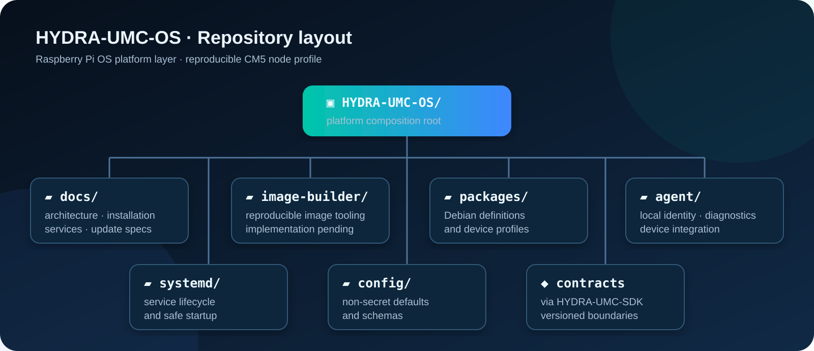

<!--
=============================================================================
HYDRA-UMC-OS - Aperçu du projet public et guide de mise en œuvre
Copyright (C) 2026 JuanenRac (Electro Hobby 3D) <electrohobby3d@gmail.com>
CC BY-SA 4.0 - voir LICENSE.md
=============================================================================
-->

  

  <a href="README.md">🇺🇸 English</a> |
  <a href="README_spa.md">🇪🇸 Español</a> |
  <a href="README_fra.md">🇫🇷 Français</a> |
  <a href="README_ita.md">🇮🇹 Italien</a> |
  <a href="README_deu.md">🇩🇪 Allemand</a> |
  <a href="README_zho.md">🇨🇳 简体中文</a> |
  <a href="README_jpn.md">🇯🇵 日本語</a> |
  <a href="README_por.md">🇵🇹 Português</a>

  
  
  
  

# HYDRA-UMC-OS

> **État de la sûreté et de la cybersécurité :** cet écosystème n'est pas un système de sécurité certifié. Il n'existe pas encore de chaîne d'E-STOP matérielle, ni de limites ou de verrouillages imposés par le firmware, ni de commande de mouvement vérifiée ; les images de firmware sont contrôlées par CRC32 et un HMAC-SHA256 à clé partagée, pas par une signature asymétrique ; TLS et TLS mutuel sont optionnels et désactivés par défaut ; aucune carte propre n'a encore été assemblée ni testée. Lisez la [base de sécurité](https://github.com/JuanenRac/HYDRA-UMC-DOCS/blob/main/docs/SECURITY_BASELINE.md) et le [modèle de menaces](https://github.com/JuanenRac/HYDRA-UMC-DOCS/blob/main/docs/THREAT_MODEL.md) avant de vous fier à une affirmation d'ici pour la sécurité d'une personne.

## 📋 En un coup d'œil

| | |
|---|---|
| Version | `0.5.3` |
| Maturité | Fonctionnel |
| Tests | 13 (`python -m unittest`) |
| Technologie | Raspberry Pi OS ARM64 / Debian/apt / systemd / udev / NetworkManager |
| Cible | Le Raspberry Pi CM5 d'une cellule HYDRA-UMC |
| Sur matériel réel | Pas encore : aucune exécution sur du matériel réel n'est consignée pour cette version |

## 🖥️ Couche de plateforme HYDRA-UMC pour Raspberry Pi OS

HYDRA-UMC-OS est la couche de plate-forme installable pour un nœud HYDRA-UMC CM5.
Il est construit sur Raspberry Pi OS ARM64 ; il ne remplace pas Linux, le
Noyau Raspberry Pi, systemd, NetworkManager, libcamera ou SDK du fournisseur.

Sa responsabilité est de fournir un profil reproductible du dispositif HYDRA-UMC :
configuration, cycle de vie du service, identité locale, diagnostics,
la marque visuelle et les mises à jour coordonnées des composants HYDRA-UMC.

**Vérification d'honnêteté - ce qui fonctionne réellement aujourd'hui :** l'agent de dispositif en lecture seule (`agent/src/hydra_umc_os/agent.py` : `DeviceDescriptor`/`HealthReport`, vérifications de température/stockage/réseau, chargement du profil de configuration) est réel et testé (13 tests unitaires, `agent/tests/test_agent.py`, `python -m unittest discover`). `provisioning/preflight_cm5.py` est vérifié comme idempotent et sans effet de bord par un test réel qui l'exécute deux fois et compare la sortie (`tools/verify_preflight_idempotent.py`), plus 5 vérifications réelles de cas négatifs (`tools/verify_preflight_negative.py`) ; le mécanisme de sauvegarde/restauration de `provisioning/rollback.py` est vérifié par 8 vérifications réelles, y compris un scénario d'échec partiel authentique (`tools/verify_rollback.py`) ; la machine à états de repli en mode AP de `provisioning/wifi_provision.py` est vérifiée par 46 vérifications réelles contre un NetworkManager factice, dont un véritable aller-retour HTTP de bout en bout sur un socket loopback réel (`tools/verify_wifi_provision.py`) - aucune des trois n'a besoin des droits root ni d'une CM5 physique pour être vérifiée. Ce qui n'a jamais été testé : du matériel CM5 réel. `image-builder/` n'est que de la documentation (un README de notes de reproductibilité, pas encore de code d'assemblage d'image) ; `packages/debian/` contient les scripts du mainteneur et le fichier de copyright du paquet `hydra-umc-platform-base`, que `tools/build_deb.py` construit en un vrai `.deb` (Python pur, sans dpkg, les mêmes octets à chaque fois) et que `tools/verify_deb_package.py` relit ; il n'a pas été installé sur une vraie CM5. Voir `CHANGELOG.md` pour ce qui a déjà été livré exactement, et `docs/CM5_SOFTWARE_READINESS.md` pour la limite exacte entre ce qui est vérifié ici et ce qui nécessite encore du matériel physique.

## 🚧 Statut

L'agent de base, sa configuration non secrète validée, une unité systemd
renforcée et des tests côté hôte sont implémentés. L'agent est délibérément
lecture seule : l'assemblage de l'image de production et la validation matérielle CM5 restent
portes de dégagement séparées.

Le preflight d'installation (`provisioning/preflight_cm5.py`) s'avère
idempotent et sans effet de bord grâce à un test réel - deux exécutions
consécutives produisent une sortie identique octet pour octet et ne
touchent aucun fichier dans ce dépôt - et un mécanisme réel de
sauvegarde/restauration (rollback), indépendant de l'hôte
(`provisioning/rollback.py`), protège l'unique fichier système que
`install_local_agent.sh` écrase inconditionnellement à chaque exécution.
Les deux sont vérifiés sans root ni CM5 - voir
`tools/verify_preflight_idempotent.py` et `tools/verify_rollback.py`.

**Le provisionnement WiFi de premier contact est réel lui aussi**
(`provisioning/wifi_provision.py` / `hydra-umc-wifi-provision.service`) :
un vrai repli en mode point d'accès NetworkManager pour un CM5 headless
sans réseau connu - il active un vrai point d'accès (`nmcli device wifi
hotspot`) auquel le téléphone/ordinateur portable d'un opérateur peut se
connecter pour soumettre le vrai SSID/mot de passe cible via un petit
formulaire HTTP local, désactive le point d'accès et rejoint le vrai
réseau en cas de succès, le restaure en cas d'échec afin que l'appareil
ne reste jamais bloqué. La machine à états est entièrement testée
unitairement contre un faux NetworkManager, y compris un véritable
aller-retour HTTP de bout en bout sur un vrai socket loopback - voir
`tools/verify_wifi_provision.py`. Installé par `install_cm5_base.sh`
mais délibérément non activé automatiquement, car il ne doit tourner que sur un appareil qui en a vraiment besoin : le mot de passe de son point d'accès et un code d'installation à usage unique sont générés pour chaque appareil au premier démarrage et lus une seule fois dans le journal - voir la section 3 de `provisioning/CM5_DEPLOYMENT_SEQUENCE.md`.

**Les secrets sont générés par appareil, jamais repris d'un modèle.** `install_server.sh` et `install_voice_ui.sh` créent leurs fichiers env à partir de l'exemple lorsqu'ils manquent et remplacent chaque valeur d'exemple (`JWT_SECRET`, le mot de passe de l'administrateur initial, le jeton du relais vocal) par une valeur aléatoire de cet appareil (`provisioning/generate_secrets.py` ; ce que l'opérateur a déjà choisi est conservé, et le mot de passe administrateur n'est affiché qu'une fois), puis refusent de continuer s'il reste une valeur d'exemple ou un secret trop court ; `preflight_cm5.py` refuse un `/etc/hydra-umc/*.env` qui en porte encore. `install_industrial_gateway.sh` écrit le `.env` de la pile (`provisioning/gateway_env.py` : le secret de la passerelle, ainsi qu'un identifiant MQTT et une règle d'ACL par bridge de machine). Le réseau Wi-Fi de configuration n'a plus de mot de passe dans le code source : chaque appareil génère le sien et un code de configuration à usage unique à son premier démarrage (à lire une fois dans le journal, pour l'écrire sur l'étiquette), le formulaire demande le code (verrouillé une minute après cinq erreurs), le réseau de configuration n'est ouvert que 30 minutes après chaque démarrage et le formulaire refuse les requêtes trop volumineuses. Vérifié par `tools/verify_generate_secrets.py`, `tools/verify_gateway_env.py` et `tools/verify_wifi_provision.py`. Le nom d'hôte et le nom du réseau de configuration se terminent aussi par six caractères tirés de l'appareil (le numéro de série du Raspberry Pi, sinon l'adresse MAC), si bien que deux appareils flashés avec la même image ne partagent plus le même nom (`provisioning/device_identity.py`, vérifié par `tools/verify_device_identity.py`) ; `HYDRA_UMC_DEVICE_SUFFIX=off` conserve les noms fixes et un nom que vous choisissez vous-même n'est jamais modifié.

## 🎯 Première étape

Terminée, selon la section État ci-dessus (code réel, tests réels, pas
encore vérifiée contre du matériel CM5 physique) :

1. ✅ Créez un profil Raspberry Pi OS ARM64 pour CM5.
2. ✅ Installez `hydra-umc-platform-base` et `hydra-umc-agent`.
3. ✅ Détectez les interfaces CM5 et signalez un `DeviceDescriptor` et un `HealthReport`.
4. ✅ Démarrez uniquement les services activés via systemd.
5. ✅ Affichez localement PRÊT, DÉGRADÉ ou DÉFAUT.

## 📂 Disposition du référentiel

  

| Chemin | Objectif |
| --- | --- |
| `docs/` | Spécifications d’architecture, d’installation, de service et de mise à jour. |
| `image-builder/` | Notes officielles sur les limites d’assemblage d’images et la reproductibilité du système d’exploitation Raspberry Pi. |
| `packages/` | Scripts du mainteneur et copyright du paquet Debian `hydra-umc-platform-base` (construit par `tools/build_deb.py`). |
| `agent/` | Descripteur de périphérique Python en lecture seule et agent d'intégrité avec tests unitaires. |
| `systemd/` | Unités de cycle de vie renforcées `hydra-umc-agent.service` et `hydra-umc-wifi-provision.service`. |
| `config/` | Schémas par défaut et configuration non secrète. |

Lisez [l'architecture](docs/ARCHITECTURE.md) avant d'implémenter le code.

## 📖 Documentation complémentaire

- **[`docs/AGENT_REFERENCE.md`](docs/AGENT_REFERENCE.md)** — référence réelle des commandes/sorties de `hydra-umc-agent`, la CLI de diagnostic en lecture seule.
- **[`docs/INSTALLATION.md`](docs/INSTALLATION.md)** — conception de l'installation : plateforme cible et séquence d'installation prévue.
- **[`docs/CM5_PROVISIONING.md`](docs/CM5_PROVISIONING.md)** — le guide complet pour transformer Raspberry Pi OS Lite en HYDRA-UMC-OS.
- **[`docs/CM5_WINDOWS_HOST_FLASHING.md`](docs/CM5_WINDOWS_HOST_FLASHING.md)** — la procédure vérifiée pour flasher une CM5 depuis un hôte Windows.
- **[`docs/CM5_FIRST_BOOT_CHECKLIST.md`](docs/CM5_FIRST_BOOT_CHECKLIST.md)** — une checklist de plateforme BASE pour le premier démarrage d'une CM5.
- **[`docs/CM5_PACKAGE_MANIFEST.md`](docs/CM5_PACKAGE_MANIFEST.md)** — la liste réelle des paquets par phase de déploiement.
- **[`docs/CM5_ECOSYSTEM_DEPLOYMENT.md`](docs/CM5_ECOSYSTEM_DEPLOYMENT.md)** — le plan de déploiement par phases, chacune révocable indépendamment, du reste de l'écosystème sur une CM5.
- **[`docs/CM5_SOFTWARE_READINESS.md`](docs/CM5_SOFTWARE_READINESS.md)** — ce qui a été vérifié sans matériel CM5 physique, et où cette vérification s'arrête.
- **[`docs/SERVICE_MODEL.md`](docs/SERVICE_MODEL.md)** — comment les services HYDRA-UMC s'exécutent : utilisateurs dédiés, chemins de configuration, ordre de dépendance/disponibilité.
- **[`docs/UPDATE_MODEL.md`](docs/UPDATE_MODEL.md)** — les canaux de mise à jour séparés pour l'OS, les paquets HYDRA-UMC, les runtimes Hailo et le firmware MCU/URTC.
- **[`docs/SDK_INTEGRATION_BOUNDARY.md`](docs/SDK_INTEGRATION_BOUNDARY.md)** — comment ce dépôt consomme le contrat publié de HYDRA-UMC-SDK sans le vendoriser.
- **[`docs/DEVELOPMENT.md`](docs/DEVELOPMENT.md)** — règles de développement : interfaces natives de Raspberry Pi OS en priorité, l'ordre de test requis.
- **[`docs/HEADER_CONVENTION.md`](docs/HEADER_CONVENTION.md)** — la convention d'en-tête copyright/licence pour les nouveaux fichiers de code et de documentation.
- **[`provisioning/ssh_hardening.md`](provisioning/ssh_hardening.md)** — les étapes réelles de durcissement SSH pour une CM5 (vérifier la connexion par clé avant de désactiver l'authentification par mot de passe).

## 🛠️ BUILD ET EXÉCUTION

Utilisez la vérification de compilation sans versionnement avant une compilation de publication :

| Action | Windows | Linux / macOS |
|---|---|---|
| Vérification de compilation (sans modifier la version ni le CHANGELOG) | `build-test.bat` | `./build-test.sh` |
| Exécution / développement (si disponible) | `run*.bat` ou `dev*.bat` | `./run*.sh` ou `./dev*.sh` |

`build-test.bat` et `build-test.sh` compilent ou valident la pile du projet sans incrémenter `hydra-umc.project.json` ni modifier `CHANGELOG.md`. Ils peuvent uniquement créer les sorties normales du compilateur. Les scripts existants `build*.bat`, `build*.sh`, `run*` et `dev*` conservent leur comportement spécifique de versionnement ou d'exécution ; utilisez-les lorsque ce comportement est requis.

## 🔗 Projets Liés

Ce projet fait partie de l'écosystème robotique HYDRA-UMC du même auteur (JuanenRac / Electro Hobby 3D). Bon à savoir, car une demande pourrait en réalité concerner l'un de ceux-ci plutôt que ce dépôt.

**Projets Enfants**
- **[HYDRA-UMC-SDK](https://github.com/JuanenRac/HYDRA-UMC-SDK)** — le contrat JSON-Schema partagé et la barrière logicielle de contrôle des jobs contre laquelle chaque bridge valide ses commandes (pas une fonction de sécurité certifiée) ; contrats versionnés, clients légers et fixtures de conformité utilisés par le propre agent d'appareil de ce système d'exploitation.
- **[HYDRA-UMC-OS-REBUILDER](https://github.com/JuanenRac/HYDRA-UMC-OS-REBUILDER)** — outil de bureau Windows/Linux qui construit une image de ce système d'exploitation prête à graver pour la CM5, préchargée avec les versions les plus actuelles de l'écosystème et une configuration de premier démarrage façon Raspberry Pi Imager.

**Directement Liés**
- **[HYDRA-UMC](https://github.com/JuanenRac/HYDRA-UMC)** — la conception de la carte mère du bras robotique : hôte CM5 + coprocesseur STM32H745 double cœur, destinée à coordonner jusqu'à 8 bras-outils via CAN-OTA/SPI-OTA (firmware à un stade précoce ; aucune carte assemblée pour l'instant) ; la plateforme matérielle et firmware CM5/MCU que cette couche système configure et supervise.
- **[HYDRA-UMC-SERVER](https://github.com/JuanenRac/HYDRA-UMC-SERVER)** — le vrai backend headless (REST/WebSocket) auquel parle réellement chaque client de contrôle ; la frontière de service authentifiée pour les intégrations gérées de ce nœud.
- **[URTC](https://github.com/JuanenRac/URTC)** — firmware pour la carte physique Universal Robot Tool Controller, plus de 25 profils d'outil sur bus CAN ; une plateforme de contrôleur d'outils indépendante intégrée via des adaptateurs explicites et versionnés.
- **[HYDRA-UMC-UPDATER](https://github.com/JuanenRac/HYDRA-UMC-UPDATER)** — outil administratif de bureau qui découvre, clone et met à jour chaque dépôt de cet écosystème ; son registre d'artefacts, ses métadonnées de compatibilité et son flux de mise à jour coordonné.
- **[HYDRA-UMC-CONNECTOR-HUB](https://github.com/JuanenRac/HYDRA-UMC-CONNECTOR-HUB)** — registre déclaratif et validateur de manifestes d'adaptateur pour les connecteurs de machines externes ; étend la propre idée de contrat du SDK aux machines externes sans remplacer les projets de passerelle industrielle.
- **[HYDRA-UMC-OPS-AGENT](https://github.com/JuanenRac/HYDRA-UMC-OPS-AGENT)** — coordinateur d'incidents de maintenance : un rôle edge à faible privilège collecte un instantané d'inventaire/santé assaini, un rôle control-plane le rend en lecture seule et demande à un fournisseur d'IA de suggérer un diagnostic - n'applique jamais de correctif ni ne déploie rien.
- **[HYDRA-UMC-DEV-SERVER](https://github.com/JuanenRac/HYDRA-UMC-DEV-SERVER)** — hôte de développement reproductible (Raspberry Pi 5 / CM5) qui héberge le code source de l'écosystème et exécute des tâches de compilation/test délimitées via une file d'attente durable ; un rôle de développement dédié, explicitement distinct d'un CM5 opérationnel.

**Fait Également Partie de l'Écosystème**

*Backend Central & Clients*
- **[HYDRA-UMC-STUDIO](https://github.com/JuanenRac/HYDRA-UMC-STUDIO)** — tableau de bord de contrôle web avec visualisation 3D multi-robot en temps réel.
- **[HYDRA-UMC-SUITE](https://github.com/JuanenRac/HYDRA-UMC-SUITE)** — centre de commande d'essaim de bureau (PySide6) pour plusieurs serveurs à la fois, empaqueté en exécutable autonome.
- **[HYDRA-UMC-ANDROID-CONTROL](https://github.com/JuanenRac/HYDRA-UMC-ANDROID-CONTROL)** — application de contrôle Android native avec connexion biométrique et un compagnon Wear OS jumelé.
- **[HYDRA-UMC-IOS-CONTROL](https://github.com/JuanenRac/HYDRA-UMC-IOS-CONTROL)** — application de contrôle iOS/iPadOS (Flutter) avec synchronisation WebSocket en temps réel.
- **[HYDRA-UMC-DSI](https://github.com/JuanenRac/HYDRA-UMC-DSI)** — interface tactile native pour l'écran tactile DSI 7" embarqué, intégrée directement sur le CM5.
- **[HYDRA-UMC-EDITOR-URDF](https://github.com/JuanenRac/HYDRA-UMC-EDITOR-URDF)** — créateur/éditeur graphique de bureau pour URDF qui envoie les modèles terminés vers le propre catalogue de STUDIO.
- **[HYDRA-UMC-EDITOR-STL](https://github.com/JuanenRac/HYDRA-UMC-EDITOR-STL)** — éditeur de bureau de modèles STL, transformant/remplaçant/retirant/ajoutant de vraies pièces dans le même catalogue de modèles qu'édite aussi HYDRA-UMC-EDITOR-URDF.
- **[HYDRA-UMC-BRIDGE-AMR](https://github.com/JuanenRac/HYDRA-UMC-BRIDGE-AMR)** — frontière de coordination pour les flottes AGV/AMR via un éditeur MQTT VDA 5050 (testé uniquement contre une flotte émulée).
- **[HYDRA-UMC-BRIDGE-CNC](https://github.com/JuanenRac/HYDRA-UMC-BRIDGE-CNC)** — coordinateur haut niveau pour cellules CNC avec accès au statut/octets de contrôle GRBL (testé uniquement contre un émulateur).
- **[HYDRA-UMC-BRIDGE-DROIDS](https://github.com/JuanenRac/HYDRA-UMC-BRIDGE-DROIDS)** — frontière de coordination pour droïdes à pattes/humanoïdes, avec un émetteur de commandes Boston Dynamics Spot (testé uniquement contre un émulateur).
- **[HYDRA-UMC-BRIDGE-LASER](https://github.com/JuanenRac/HYDRA-UMC-BRIDGE-LASER)** — coordinateur de cellules laser lisant 3 signaux GPIO de clé/enceinte/verrouillage (testé uniquement contre une puce simulée ; il ne peut ni armer ni tirer un laser).
- **[HYDRA-UMC-BRIDGE-OPENPNP](https://github.com/JuanenRac/HYDRA-UMC-BRIDGE-OPENPNP)** — coordinateur haut niveau sûr pour le flux de cartes du pick-and-place OpenPnP.
- **[HYDRA-UMC-BRIDGE-PRINTER3D](https://github.com/JuanenRac/HYDRA-UMC-BRIDGE-PRINTER3D)** — frontière de coordination sûre pour imprimantes 3D Moonraker/Klipper, avec de vraies commandes de tâche contrôlées.
- **[HYDRA-UMC-BRIDGE-ROS2](https://github.com/JuanenRac/HYDRA-UMC-BRIDGE-ROS2)** — coordinateur avec un transport ROS 2 rclpy à importation paresseuse (pas encore exécuté contre une installation ROS 2).
- **[HYDRA-UMC-BRIDGE-UAV](https://github.com/JuanenRac/HYDRA-UMC-BRIDGE-UAV)** — frontière de coordination pour UAV équipés de caméra, avec un émetteur de commandes MAVLink (testé uniquement contre un émulateur).

*Plateforme d'Outils URTC*
- **[URTC-FLASHER](https://github.com/JuanenRac/URTC-FLASHER)** — outil de bureau à interface graphique pour flasher les cartes URTC, CAN-OTA plus SWD/JTAG puce complète.
- **[URTC-TESTER](https://github.com/JuanenRac/URTC-TESTER)** — outil de bureau de diagnostic CAN-bus en direct pour cartes URTC, un panneau par profil d'outil.
- **[URTC-WEB-STUDIO](https://github.com/JuanenRac/URTC-WEB-STUDIO)** — alternative basée navigateur à URTC-TESTER via la Web Serial API, sans installation locale.

*Nœud IA de Vision (Hailo-8)*
- **[HYDRA-UMC-VISION-NODE](https://github.com/JuanenRac/HYDRA-UMC-VISION-NODE)** — hub d'intégration pour le pipeline de vision Hailo-8, avec une vraie vérification de disponibilité matérielle par étape.
- **[HYDRA-UMC-DETECTION-HEF](https://github.com/JuanenRac/HYDRA-UMC-DETECTION-HEF)** — registre réel de modèles compilés avec vérification de chargement sécurisé par architecture Hailo/checksum.
- **[HYDRA-UMC-VISION-STREAMER](https://github.com/JuanenRac/HYDRA-UMC-VISION-STREAMER)** — générateur réel de pipeline GStreamer + config MediaMTX, avec une vraie frontière d'intégration HailoRT.
- **[HYDRA-UMC-VISUAL-SERVOING-API](https://github.com/JuanenRac/HYDRA-UMC-VISUAL-SERVOING-API)** — loi de correction Position-Based Visual Servoing avec autorisation conditionnée à l'état de zone ; pas encore d'estimation de pose par caméra.
- **[HYDRA-UMC-SAFETY-ZONES](https://github.com/JuanenRac/HYDRA-UMC-SAFETY-ZONES)** — logique v0 de violation de zone, de fraîcheur de calibration et de demande d'E-STOP qui lit les positions d'objets dans un fichier ; aucun détecteur ne l'alimente et aucun E-STOP physique n'y est encore relié.

*Nœud IA Cognitif (Hailo-10)*
- **[HYDRA-UMC-COGNITIVE-NODE](https://github.com/JuanenRac/HYDRA-UMC-COGNITIVE-NODE)** — hub d'intégration pour le pipeline cognitif Hailo-10 (orchestration LLM/VLA/voix).
- **[HYDRA-UMC-VLA-ENGINE](https://github.com/JuanenRac/HYDRA-UMC-VLA-ENGINE)** — vrai encodage/décodage de jetons d'action et génération de trajectoire pour un modèle Vision-Language-Action.
- **[HYDRA-UMC-VOICE-UI](https://github.com/JuanenRac/HYDRA-UMC-VOICE-UI)** — vrai front-end vocal (VAD + analyseur d'intention) avec un relais Watch borné et soumis à confirmation.
- **[HYDRA-UMC-SEMANTIC-PLANNER](https://github.com/JuanenRac/HYDRA-UMC-SEMANTIC-PLANNER)** — vraie décomposition de tâches basée sur des règles et récupération sémantique d'erreurs sur les codes d'erreur MCU.
- **[HYDRA-UMC-DOCS-QA](https://github.com/JuanenRac/HYDRA-UMC-DOCS-QA)** — vraie recherche documentaire TF-IDF (bibliothèque standard uniquement) sur les propres documents Markdown de cet écosystème.
- **[HYDRA-UMC-LOCAL-TECHNICIAN](https://github.com/JuanenRac/HYDRA-UMC-LOCAL-TECHNICIAN)** — technicien de maintenance IA local et à portes de politique pour l'écosystème lui-même - observe, diagnostique et propose des corrections ; les deux niveaux de risque les plus élevés ne sont délibérément pas encore implémentés.

*Orchestration & Essaim*
- **[HYDRA-UMC-ORCHESTRATOR](https://github.com/JuanenRac/HYDRA-UMC-ORCHESTRATOR)** — hub d'intégration avec un vrai contrat de rapport de santé gRPC/Protobuf et une machine à états de mission.
- **[HYDRA-UMC-JOB-DISPATCHER](https://github.com/JuanenRac/HYDRA-UMC-JOB-DISPATCHER)** — vraie file de tâches basée sur la priorité avec déduplication, via une vraie API HTTP.
- **[HYDRA-UMC-NODE-HEALING](https://github.com/JuanenRac/HYDRA-UMC-NODE-HEALING)** — vrai chien de garde de santé de flotte basé sur gRPC, avec retry/backoff et détection d'incohérence d'identité.
- **[HYDRA-UMC-PATH-PLANNER-3D](https://github.com/JuanenRac/HYDRA-UMC-PATH-PLANNER-3D)** — vrai planificateur de trajectoire 3D basé sur RRT, avec vraie validation des collisions obstacle/espace de travail.
- **[HYDRA-UMC-SWARM-SYNC](https://github.com/JuanenRac/HYDRA-UMC-SWARM-SYNC)** — vraie synchronisation d'état CRDT LWW-Element-Map, testée par propriétés pour la convergence multi-cellule.

*Jumeau Numérique & Simulation*
- **[HYDRA-UMC-TWIN](https://github.com/JuanenRac/HYDRA-UMC-TWIN)** — hub d'intégration pour le moteur de jumeau numérique, avec un vrai contrat de synchronisation par compatibilité de version.
- **[HYDRA-UMC-HIL-BRIDGE](https://github.com/JuanenRac/HYDRA-UMC-HIL-BRIDGE)** — routeur hardware-in-the-loop avec un verrouillage logiciel de collision entre simulation et matériel réel (testé sans matériel réel).
- **[HYDRA-UMC-PHYSICS-REPLICA](https://github.com/JuanenRac/HYDRA-UMC-PHYSICS-REPLICA)** — vraie cinématique directe et validation des limites articulaires sur un vrai sous-ensemble URDF.
- **[HYDRA-UMC-SYNTHETIC-DATA-GEN](https://github.com/JuanenRac/HYDRA-UMC-SYNTHETIC-DATA-GEN)** — vrai générateur procédural de scènes 2D avec export d'annotations YOLO/COCO.

*Données & Analytique*
- **[HYDRA-UMC-DATALAKE](https://github.com/JuanenRac/HYDRA-UMC-DATALAKE)** — vrai magasin de séries temporelles basé sur sqlite3, avec une vraie API HTTP d'ingestion/requête.
- **[HYDRA-UMC-ANOMALY-DETECTOR](https://github.com/JuanenRac/HYDRA-UMC-ANOMALY-DETECTOR)** — vrai détecteur d'anomalies FFT + ligne de base statistique, avec surveillance de dérive.
- **[HYDRA-UMC-PRODUCTION-REPORTS](https://github.com/JuanenRac/HYDRA-UMC-PRODUCTION-REPORTS)** — vrai calcul OEE/disponibilité sur l'historique de DATALAKE, avec export CSV reproductible.
- **[HYDRA-UMC-TELEMETRY-COLLECTOR](https://github.com/JuanenRac/HYDRA-UMC-TELEMETRY-COLLECTOR)** — vrai pipeline d'ingestion CAN/WebSocket vers DATALAKE, avec déduplication par séquence.

*Passerelle Industrielle*
- **[HYDRA-UMC-GATEWAY-INDUSTRIAL](https://github.com/JuanenRac/HYDRA-UMC-GATEWAY-INDUSTRIAL)** — hub d'intégration relayant vers les protocoles industriels, avec une vraie couche de liste blanche de commandes/contre-pression.
- **[HYDRA-UMC-OPCUA-SERVER](https://github.com/JuanenRac/HYDRA-UMC-OPCUA-SERVER)** — vrai espace d'adressage OPC-UA, vérifié avec une vraie session client du protocole binaire.
- **[HYDRA-UMC-MQTT-BROKER](https://github.com/JuanenRac/HYDRA-UMC-MQTT-BROKER)** — vrai broker MQTT avec authentification par client optionnelle et ACL de sujets.
- **[HYDRA-UMC-MTCONNECT-ADAPTER](https://github.com/JuanenRac/HYDRA-UMC-MTCONNECT-ADAPTER)** — vrais points de terminaison XML MTConnect `/probe` et `/current`, avec sortie en mode dégradé.

*Outils Complémentaires & Opérations de l'Écosystème*
- **[HYDRA-UMC-DASHBOARD-AI](https://github.com/JuanenRac/HYDRA-UMC-DASHBOARD-AI)** — panneaux Smart Summaries et Anomaly Highlighting sur DATALAKE/ANOMALY-DETECTOR, avec un repli statistique honnête.
- **[HYDRA-UMC-TOOL-CLI](https://github.com/JuanenRac/HYDRA-UMC-TOOL-CLI)** — CLI de flotte avec un vrai contrat de codes de sortie stable, un vrai client en direct de la propre API de HYDRA-UMC-SERVER.
- **[HYDRA-UMC-WATCH](https://github.com/JuanenRac/HYDRA-UMC-WATCH)** — application compagnon WearOS avec des motifs d'alerte haptique et un relais vocal vers le téléphone jumelé (pas encore exécutée sur une montre physique).
- **[URTC-SMART-RACK](https://github.com/JuanenRac/URTC-SMART-RACK)** — firmware pour un rack de montage de cartes avec décodage réel d'ID d'outil et logique de préchauffage Smart Idle.
- **[URTC-VISION-TOOL](https://github.com/JuanenRac/URTC-VISION-TOOL)** — firmware plus un vrai compagnon de vision Python pour une tête d'outil d'inspection thermique/RGB.

---

## 📚 Documentation & Communauté

- **[CONTRIBUTING.md](CONTRIBUTING.md)** — pile technologique et lignes directrices de codage pour une pull request.
- **[CODE_OF_CONDUCT.md](CODE_OF_CONDUCT.md)** — les normes de comportement attendues dans cette communauté.
- **[SECURITY.md](SECURITY.md)** — comment signaler une vulnérabilité, et les véritables axes de sécurité de ce projet.
- **[SUPPORT.md](SUPPORT.md)** — où poser des questions et signaler des bugs.
- **[LICENSE.md](LICENSE.md)** — la licence propre de ce projet.

## 👤 AUTEUR
**JuanenRac** (Electro Hobby 3D)
📧 electrohobby3d@gmail.com
📺 [youtube.com/@electrohobby3d](https://youtube.com/@electrohobby3d)

## 📜 LICENCE

Le code est GPL-3.0-or-later ou version ultérieure et la documentation est CC BY-SA 4.0. Voir [LICENCE](LICENSE).
